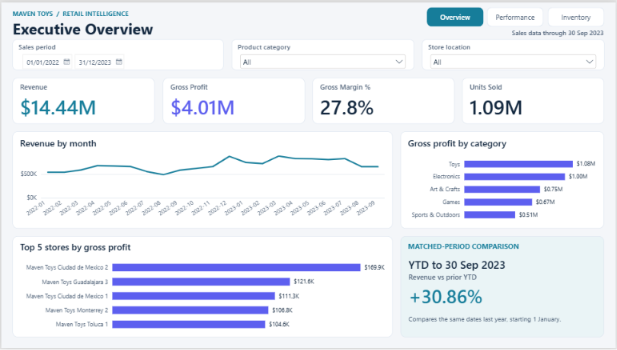

# Maven Toys Power BI Report

A sales and inventory report for a fictional toy retailer with 50 stores in Mexico. The sales data runs from January 2022 to September 2023. I used Power Query to prepare the CSVs and DAX for revenue, gross profit, margin and year-to-date comparisons.

## Report pages

- **Executive Overview** covers sales trends, key figures and the year-to-date comparison.
- **Product & Store Performance** ranks products and stores by gross profit and compares margins across categories.
- **Inventory Snapshot** shows stock on hand, inventory value at cost and recorded store-product pairs with zero stock.

The report also includes a **QA Checks** page for the YTD comparison.

## What I found

- Revenue grew **30.9%** in January–September 2023 compared with the same months in 2022, while gross margin fell from **29.55% to 26.20%**.
- **Colorbuds** generated the most gross profit of any product at **$834,944** over the full sales period.
- The inventory snapshot shows **77 of 1,593 recorded pairs** with zero stock. The snapshot date is unknown.

## Open and refresh

1. Download and extract this repository. Open the report in Power BI Desktop. [Maven_Toys_Complete.pbix](report/Maven_Toys_Complete.pbix)
2. To refresh from the included CSVs, open **Transform data** and point `pDataFolder` at the extracted `data` folder. For a report using direct file paths, update the paths in **Data source settings**.
3. Apply the changes and refresh. Revenue for the full period with all categories and stores selected should be **$14,444,572.35**.

Revenue and gross profit use the listed product prices and costs in USD. Gross profit excludes operating expenses. The source CSVs and data dictionary are in `data/`. [Maven Analytics Mexico Toy Sales](https://mavenanalytics.io/data-playground/mexico-toy-sales)
